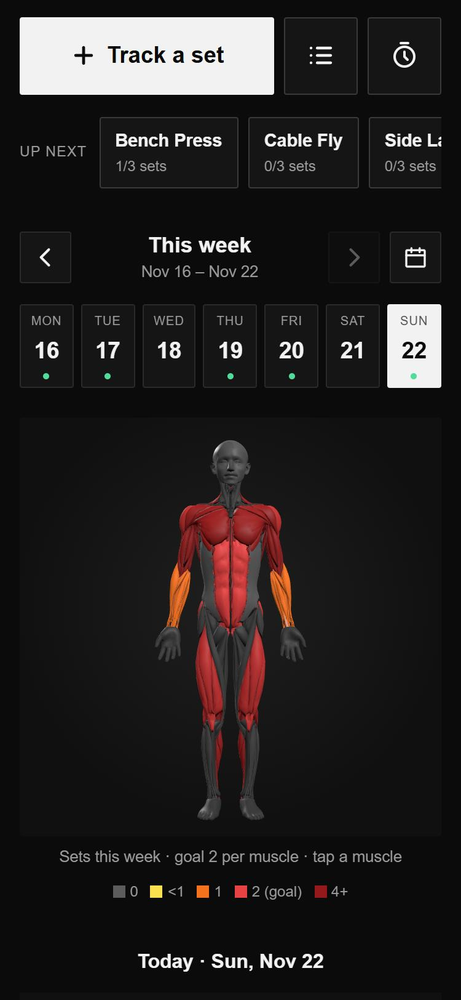
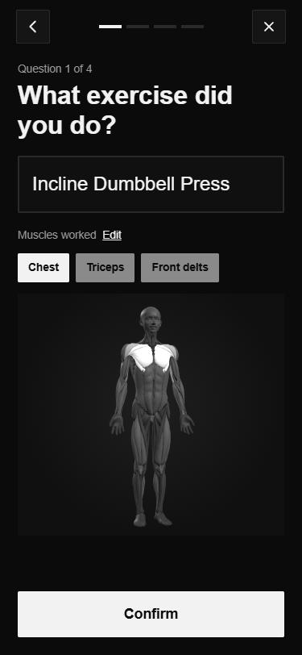
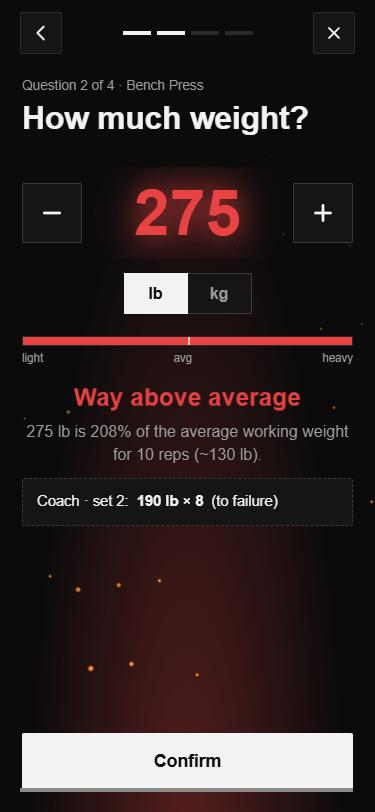
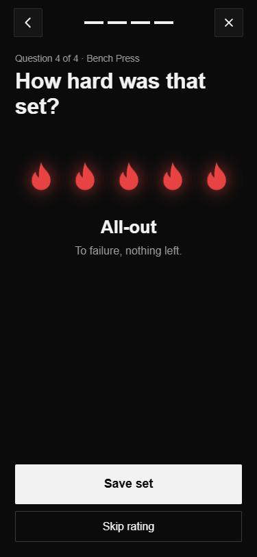
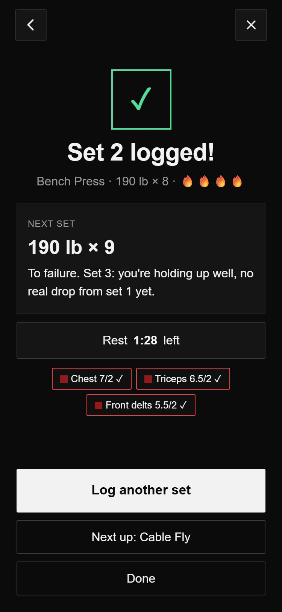
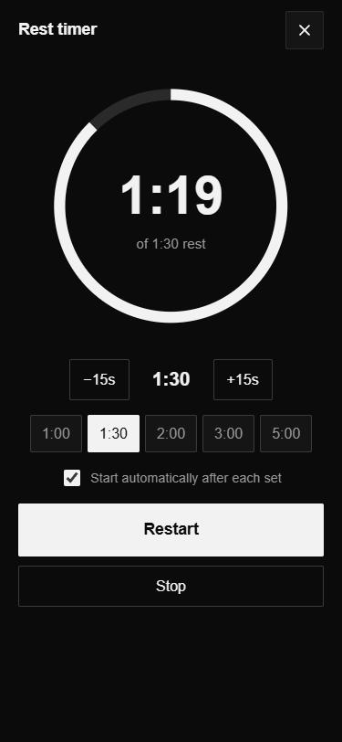
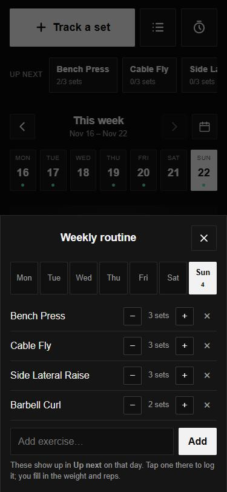
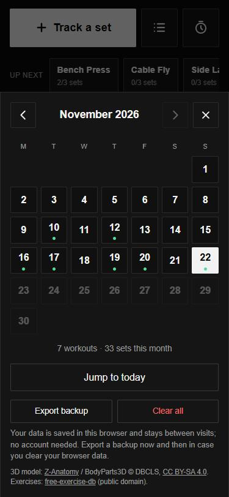

# EZRep

  

  

  
  
  
  
  

**Live:** https://ezrep-fawn.vercel.app

Super simple gym progress tracker.

  

## Screenshots

<table>
  <tr>
    <td align="center"> <b>1 · Pick the exercise</b> muscles light up on the model</td>
    <td align="center"> <b>2 · Enter the weight</b> live effects vs. the average lifter</td>
    <td align="center"> <b>3 · Rate the effort</b> 1–5 fires tune your next set</td>
    <td align="center"> <b>4 · Set logged</b> next-set advice + rest countdown</td>
  </tr>
  <tr>
    <td align="center"> <b>Rest timer</b> counts down, then beeps</td>
    <td align="center"> <b>Weekly routine</b> feeds the Up next queue</td>
    <td align="center"> <b>Calendar</b> jump to any past workout</td>
    <td align="center"> <b>Weekly muscle map</b> goal: 2 sets per muscle</td>
  </tr>
</table>

---

## Features

- **Track a set** in 4 full-screen questions: exercise, weight, reps, and **how hard it was** (1-5 fires).
  The fire rating becomes reps in reserve (5 = failure, 4 = 1 left, 3 = 2 left, 2 = 3 left, 1 = 5+ left),
  which tunes the 1RM estimate and the next set's weight and reps.
- **800+ exercises.** Typing searches a public-domain exercise database ([free-exercise-db](https://github.com/yuhonas/free-exercise-db))
  and fills in primary and secondary muscles. Your own muscle picks always win.
- **Weekly muscle map.** The 3D model shows this week's sets per muscle against a goal of 2.
  Grey means still to train. A 2-week date strip, week arrows, swipe and a month calendar let you look back. Future days are locked.
- **Weekly routine + Up next queue.** Plan exercises per weekday. Today's appear as a queue; tap one to log it.
- **Rest timer.** Ring countdown with presets, ±15s, auto-start after each set, and a beep and vibration when rest is over.
- Foldable set list per exercise.

---

## Your data

Everything is saved in your browser's localStorage on that device. It stays there between visits, so
there's nothing to download each day. EZRep also asks the browser to keep the storage persistent. On
iPhone, add it to your Home Screen so Safari doesn't clear site data for apps you haven't opened in a while.
*Export backup* (in the calendar sheet) is only a safety copy. Data doesn't sync between devices.

---

## Credits

The 3D muscle model is from [Z-Anatomy](https://github.com/Z-Anatomy/Models-of-human-anatomy) /
BodyParts3D © DBCLS, via [hoik-muscle-model](https://github.com/kalibismail/hoik-muscle-model),
licensed [CC BY-SA 4.0](https://creativecommons.org/licenses/by-sa/4.0/). See [CREDITS.md](CREDITS.md).
